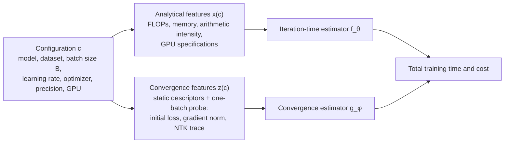

# 🕒 CHRONOS: A Unified Framework for Predicting Training Time and Convergence in Deep Learning

<p align="center">
  
</p>
<p align="center" style="font-size: 11px;">
  [This logo was generated using DALL·E 3 by OpenAI]
</p>

<p align="center">
  <a href="https://openreview.net/pdf?id=gDLPOEjQTH"></a>
  
  <a href="./LICENSE"></a>
  
</p>

<p align="center">
  Alireza Pourali, Arian Boukani, Hamzeh Khazaei<br>
  PACS Lab, York University<br>
  <i>Transactions on Machine Learning Research (TMLR), 2026</i><br>
  <a href="https://openreview.net/pdf?id=gDLPOEjQTH"><b>Paper</b></a>
</p>

---

## Overview

Estimating how long a training run will take, and what it will cost, usually means running part of it first. CHRONOS predicts both before training begins.

It splits end-to-end training time into two quantities and learns each separately:

1. the duration of one training iteration on a given GPU, estimated from analytical compute and hardware descriptors;
2. the number of epochs until convergence, estimated from a single initialization-time probe on one mini-batch together with model, dataset and optimization descriptors.

We evaluated CHRONOS on nine architectures, from lightweight models such as MobileNetV2 and DeiT-Tiny to ViT, ResNet-50 and DenseNet-121, and on ten GPUs. It reaches a mean absolute percentage error (MAPE) of **13.7%** for iteration time and **22.1%** for the convergence epoch.

## Method



**Iteration time.** For a configuration $c$, CHRONOS builds the feature vector $\mathbf{x}(c)$ from training FLOPs, parameter, activation and optimizer-state memory, arithmetic intensity, batch size, numerical precision and GPU specifications. A gradient-boosted tree regressor (XGBoost) then predicts

$$
\hat{t}^{\text{iter}} = f_\theta\big(\mathbf{x}(c)\big).
$$

Layer-wise predictors such as PreNeT sum per-layer estimates. CHRONOS instead models the network as a whole, so cross-layer and hardware effects are captured through feature interactions.

**Convergence.** The convergence epoch is predicted as

$$
\hat{T}_{\text{conv}} = g_\phi\big(\mathbf{z}(c)\big),
$$

where $\mathbf{z}(c)$ combines parameter count, dataset size, learning rate and batch size with three probe features: the initial loss $\ell_0$, the gradient norm $g^2$ and the normalized trace $\tau$ of the empirical neural tangent kernel. The probe is one forward and one backward pass on a single mini-batch at initialization. No optimizer step is taken, and the estimator never sees a training trajectory or validation curve.

**End-to-end estimate.** For a dataset of $N$ samples and a GPU with hourly price $\rho_{\text{GPU}}$,

$$
\hat{T}_{\text{total}} = \hat{T}_{\text{conv}} \times \frac{N}{B} \times \hat{t}^{\text{iter}},
\qquad
\widehat{\text{Cost}} = \frac{\hat{T}_{\text{total}}}{3600} \times \rho_{\text{GPU}}.
$$

Both estimators are trained offline once. Predicting a new configuration requires only the probe.

## Results

### Iteration-time prediction

RMSE in milliseconds on an 80/10/10 random split, compared with [PreNeT](https://github.com/pacslab/PreNeT) (Pourali et al., 2025).

| Model | PreNeT | CHRONOS | Reduction |
|:--|--:|--:|--:|
| AS-MLP | 23.32 | **16.91** | 27% |
| MLP-Mixer | 34.54 | **13.86** | 60% |
| ResMLP | 25.43 | **11.53** | 55% |
| DenseNet-121 | 54.34 | **23.15** | 57% |
| MobileNetV2 | 25.43 | **11.40** | 55% |
| ResNet-50 | 43.45 | **22.95** | 47% |
| VGG-16 | 19.34 | **10.45** | 46% |
| DeiT-Tiny | 30.43 | **12.23** | 60% |
| ViT | 69.43 | **28.96** | 58% |

Under grouped evaluation, CHRONOS has a lower RMSE than PreNeT in all 23 held-out groups. The average reductions are 52.5% for leave-one-model-out, 49.9% for leave-one-dataset-out and 48.0% for leave-one-GPU-out.

### Convergence prediction

MAPE (%) of the predicted convergence epoch; lower is better. The NTK-guided baseline is adapted from Zancato et al. (2020). The scaling-law baseline regresses on $\log P$ and $\log N$ (Kaplan et al., 2020).

| Model | Scaling law | NTK-guided | CHRONOS |
|:--|--:|--:|--:|
| AS-MLP | 72.68 | 38.05 | **35.33** |
| MLP-Mixer | 82.41 | 20.03 | **19.06** |
| ResMLP | 74.32 | 27.88 | **19.86** |
| DenseNet-121 | 36.92 | 17.88 | **12.47** |
| MobileNetV2 | 27.52 | 24.03 | **22.91** |
| ResNet-50 | 24.62 | 18.91 | **13.63** |
| VGG-16 | 47.35 | 37.61 | **33.06** |
| DeiT-Tiny | 21.34 | 21.14 | **18.60** |
| ViT | 42.85 | 40.65 | **24.21** |
| **Average** | 47.78 | 27.35 | **22.13** |

### Further observations

1. The probe is inexpensive. With $N = 50{,}000$ and $B = 128$ an epoch has 391 mini-batches, while the probe uses one, which is less than 0.3% of an epoch.
2. The probe adds information that static descriptors lack. Removing the three probe features raises the average convergence MAPE from 22.13% to 31.68%. Constant mean and median predictors reach 42.80% and 42.13%.
3. Larger probe batches do not consistently help. For DenseNet-121, MobileNetV2, ResNet-50, VGG-16, DeiT-Tiny and ViT, the smallest probe batch gave the lowest error. We suggest 32 to 64 samples for CNNs and Transformers, and 64 to 128 for token-mixing MLPs.
4. The hourly price of a GPU is a poor guide to the total cost of a run. For ViT on CIFAR-100, a consumer RTX 5090 converged faster and more cheaply than an A100, V100 or L40S. For ResNet-50 on TinyImageNet, where the end-to-end prediction error was 9.4%, the T4 had the lowest hourly rate, but the A40 reached convergence at a lower total cost. The V100 run was the most expensive.
5. The feature representation also transfers to text. On LSTM, GRU, BiLSTM and GNMT models trained on IMDB, AG News, SST-2, WMT14 En-De and CNN/DailyMail, the iteration-time MAPE is 6.18% (see the appendix of the [paper](https://openreview.net/pdf?id=gDLPOEjQTH)).
6. XGBoost was chosen by ablation. It reaches an average iteration-time MAPE of 13.70%, compared with 18.41% for a random forest and 20.71% for an MLP regressor.

## Installation

CHRONOS requires Python 3.11.

```bash
git clone https://github.com/pacslab/chronos.git
cd chronos
pip install -e .
```

On first use, the package downloads its pretrained regressors to `chronos/models/` and the probe dataset to `./data/`.

On macOS with the python.org installer, a `CERTIFICATE_VERIFY_FAILED` error during the dataset download means Python's root certificates are not installed. Running `/Applications/Python\ 3.11/Install\ Certificates.command` once fixes it.

## Usage

```python
import chronos

predictor = chronos.TrainingTimePredictor(model=chronos.Models.VGG16,
                                          dataset=chronos.Datasets.Cifar100,
                                          optimizer=chronos.Optimizers.SGD,
                                          batch_size=32,
                                          learning_rate=0.001,
                                          precision=16,
                                          gpu=chronos.Devices.T4)

epoch_time = predictor.predict_epoch_time()            # seconds per epoch
epochs = predictor.predict_number_of_epochs()          # epochs to converge
hours = epoch_time * epochs / 3600
cost = hours * chronos.Devices.T4.specs["$/hr"]        # USD, on-demand price

print(f"Epoch time: {epoch_time:.2f} s")
print(f"Epochs to converge: {epochs:.1f}")
print(f"Total: {hours:.2f} h  (~${cost:.2f})")
```

Example output:

```text
Predictor configured for: VGG16 on T4
Optimizer: SGD, Dataset: CIFAR100
Files already downloaded and verified
Epoch time: 251.29 s
Epochs to converge: 21.0
Total: 1.46 h  (~$0.41)
```

The probe runs on CUDA when it is available and falls back to the CPU otherwise. The target GPU does not need to be present.

## Supported configurations

The released predictors were trained on the following combinations.

| Family | Models | Datasets | Optimizers |
|:--|:--|:--|:--|
| CNN | ResNet-50, VGG-16, MobileNetV2, DenseNet-121 | CIFAR-10, CIFAR-100, TinyImageNet, STL-10 | SGD, AdamW |
| Token-mixing MLP | MLP-Mixer, ResMLP, AS-MLP | CIFAR-100, TinyImageNet, STL-10 | SGD, AdamW |
| Transformer | ViT, DeiT-Tiny, DistilBERT | CIFAR-100, TinyImageNet, STL-10, SST-2, IMDB | Adam, AdamW, Adafactor |

GPUs: H100, A100, L40S, RTX 5090, A40, L4, V100, T4, P100 and P4. Precision: FP16 and FP32.

## Reproducing the experiments

The meta-datasets were collected on ten GPUs: five on Google Cloud (L4, T4, V100, P4, P100) and five on RunPod (H100, A100 80 GB, L40S, RTX 5090, A40). Each configuration is timed over 5 warm-up batches followed by 20 measured batches. Convergence labels come from validation-based early stopping on an 80/20 split, with an improvement threshold $\delta = 5 \times 10^{-4}$ and a patience of 7 epochs. Collecting both meta-datasets took about 480 GPU hours. The released data contains 10,680 timing measurements and 324 training runs to convergence.

| Folder | Purpose |
|:--|:--|
| `epoch_time_collection/` | Benchmarks per-batch training time on the local GPU |
| `epoch_time_prediction/` | Trains and evaluates the iteration-time estimator (random split, LODO, LOMO) |
| `epoch_convergence_prediction/` | Trains and evaluates the convergence estimator from probe features |

Each folder contains `CNN.py`, `MLP.py` and `Transformer.py`. Run the scripts from inside their folder, because they read `./data/*.csv`.

```bash
cd epoch_time_collection && python CNN.py --models resnet50 vgg16 --batch-sizes 32 64
```

```bash
cd epoch_time_prediction && python CNN.py
```

```bash
cd epoch_convergence_prediction && python CNN.py
```

## Limitations

CHRONOS was evaluated on single-GPU, full-parameter training from scratch, mostly on image classification. It does not cover large language models, distributed training or parameter-efficient fine-tuning such as LoRA. The predicted total excludes validation passes, and recipe choices such as data augmentation, learning-rate schedules, warm-up and weight decay are not modeled. Convergence labels were collected with a fixed seed, so the reported errors do not reflect seed-to-seed variation. The estimates are intended for planning and should be used with a budget margin.

## Citation

```bibtex
@article{pourali2026chronos,
  title   = {Chronos: A Unified Framework for Predicting Training Time and Convergence in Deep Learning},
  author  = {Pourali, Alireza and Boukani, Arian and Khazaei, Hamzeh},
  journal = {Transactions on Machine Learning Research},
  issn    = {2835-8856},
  year    = {2026},
  url     = {https://openreview.net/forum?id=gDLPOEjQTH}
}
```

Related work from our lab: [PreNeT](https://github.com/pacslab/PreNeT) (ICPE 2025) predicts layer-level training time from computational features.

## License

This project is released under the [MIT License](./LICENSE).
